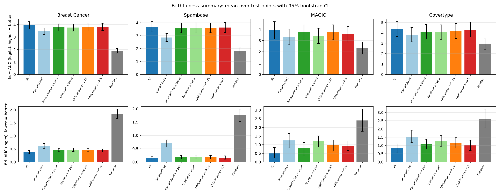
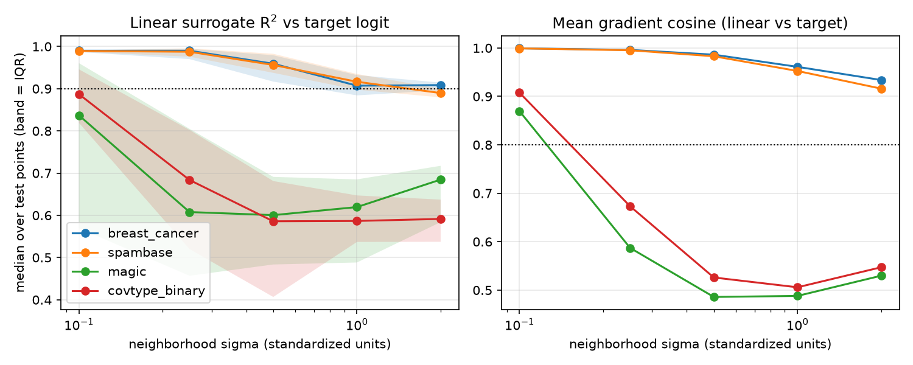
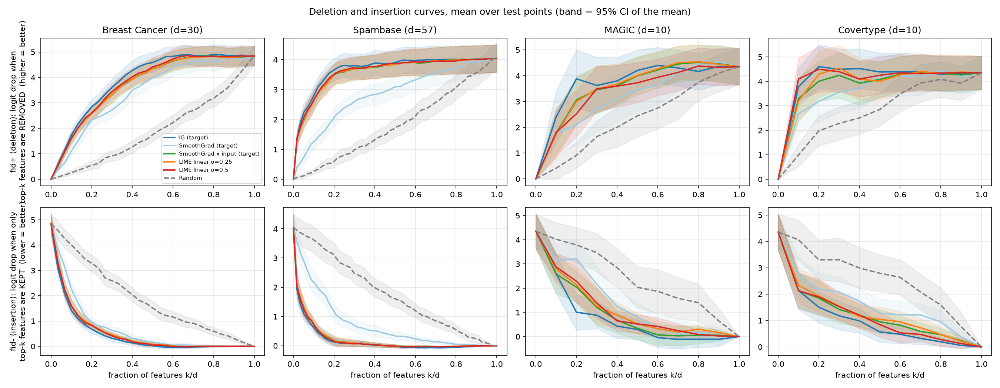
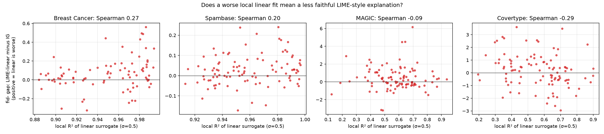
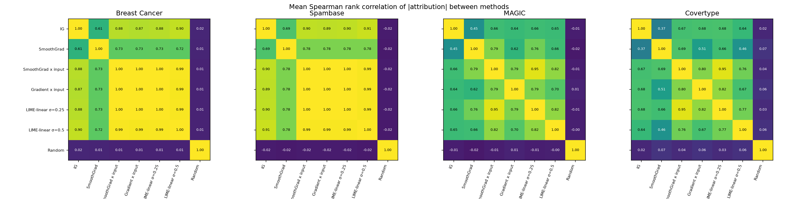
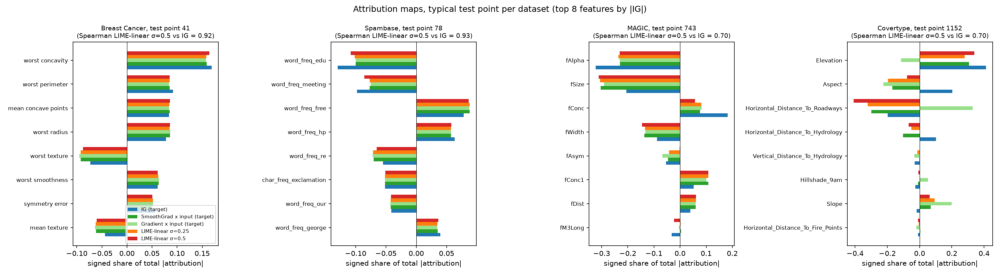
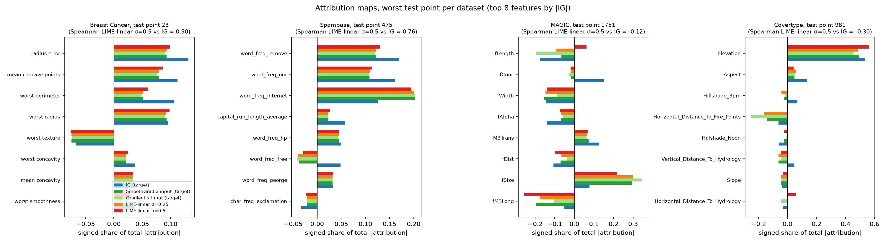
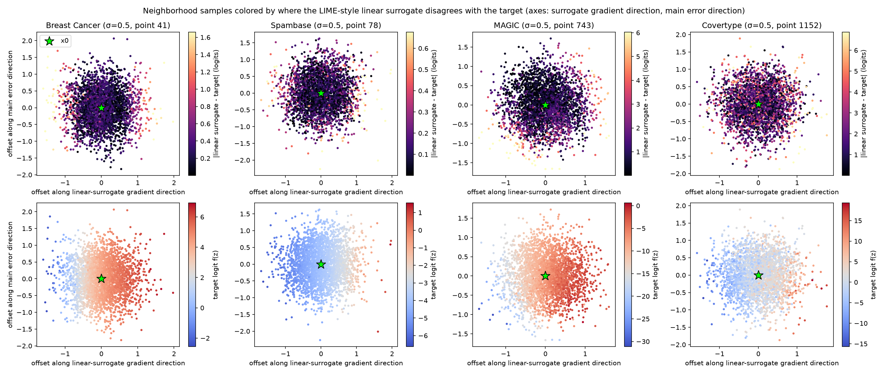

# Baseline Explanation Results: Do LIME-style Linear Surrogates Explain a Complex Tabular Model Faithfully?

CPSC 4710 project, "Can a nonlinear surrogate model provide more faithful explanations of a white-box model?"
Arush Srivastava, Anay Seth, Lucas Papamitsakis · baseline stage · figures and tables generated by `scripts/analyze_baselines.py`, assembled by `scripts/build_report.py`

> **Scope.** This report covers only the **baselines** (IG, SmoothGrad, gradient × input, and a LIME-style linear surrogate, all explaining a Tabular ResNet). The nonlinear surrogate and Sobolev training, which are the project's actual method, are **not built yet**, so nothing here says whether that method works. What this report does is establish how good the baselines are and how much room there is to improve on them.

---

## 1. Summary

**Headline results**

1. **The pipeline passes its sanity checks.** Integrated Gradients (IG) satisfies completeness to within 0.0076 logits (mean ≤ 0.0007). Every real method is far better than a random ranking on every dataset (e.g. fid⁻ 0.1–1.5 vs. 1.8–2.6). The randomization test passes once the input-magnitude factor is removed (§4).
2. **The premise that a linear surrogate has room to fail holds, and it replicates on all three trained ResNets.** In neighborhoods of σ = 0.5, the median R² of the linear surrogate against the ResNet is 0.56–0.60 on MAGIC and 0.56–0.59 on Covertype, against 0.93–0.97 on Breast Cancer and Spambase (§5).
3. **That poor linear fit does not (yet) translate into a clearly less faithful explanation.** Measured by fid⁺/fid⁻ against the target, the LIME-style linear explanation is only slightly worse than IG on the target. On Breast Cancer and Spambase the gap is tiny but consistent (fid⁻ +0.04 to +0.14 logits worse in all three seeds at σ = 0.25). On MAGIC and Covertype the gap is larger in one seed and **vanishes or reverses in the others** (fid⁻ gap at σ = 0.5: MAGIC +0.41 / −0.10 / +0.03, Covertype +0.18 / −0.17 / +0.07 across seeds 0/1/2). Only one of those six comparisons is statistically significant (§6). **An earlier summary of ours that called the linear surrogate "clearly less faithful" on the nonlinear datasets came from seed 0 alone and overstated this.**
4. **The explanations do differ in *what they say*.** Even after removing the shared |x| factor, the rank agreement between the linear explanation and IG is about 0.9 on the near-linear datasets but only 0.58 (MAGIC) and 0.42 (Covertype) on the nonlinear ones. On MAGIC, the sign of the linear attribution agrees with IG's on only 54% of IG's top-5 features, about chance (§7).
5. **Infidelity separates the methods more than fid⁺/fid⁻ does** on the nonlinear data (MAGIC: IG 11.1 vs. LIME-linear 43.6–49.6; Covertype: 7.0 vs. 10.1–15.5), but this is from one trained model and has no confidence intervals yet (§8).
6. **Implication for the project.** Direct IG on the target is already close to the ceiling on fid⁺/fid⁻ (fid⁻ of 0.1–0.8 logits), so there is little room above it on those two metrics, and our comparisons are noisy at 100 test points. The metrics that show real headroom are surrogate fit, rank agreement with IG and infidelity. The evaluation plan for the nonlinear surrogate should lean on those, and use many more test points (§11).

**Verdict on the proposal's success criteria (§6.3 of the proposal).** (1) *Local surrogate quality in outputs and gradients:* measured here for the linear baseline only (low on the nonlinear data, by design the headroom). (2) *Better fid⁺/fid⁻ for surrogate-based explanations:* **cannot be assessed yet**; this report sets the bar the nonlinear surrogate must clear.

---

## 2. What was run

### 2.1 Targets

A Tabular ResNet (Gorishniy et al. 2021, re-implemented in PyTorch; 4 residual blocks, width 128, GELU, batch-norm, 266k–272k parameters), trained with 3 seeds per dataset on a fixed stratified 70/15/15 split. All explanations are of the **positive-class logit**. Inputs are standardized with training-split statistics, so "x′ = 0" means the training mean. Details: `docs/DATA.md`, `docs/DESIGN_DECISIONS.md`.

| dataset | role | n test | ResNet test accuracy (3 seeds) | ResNet test AUC | logistic-regression test accuracy |
|---|---|---|---|---|---|
| Breast Cancer | proposal dataset, near-linear control | 86 | 94.19% ± 0.00 | 0.988 | 97.67% |
| Spambase | proposal dataset, near-linear control | 691 | 95.03% ± 0.36 | 0.982 | 95.08% |
| MAGIC | **added**, nonlinear | 2,853 | 87.62% ± 0.25 | 0.932 | 78.41% |
| Covertype (binary, 10 continuous features, 20k subsample) | **added**, nonlinear | 3,000 | 85.52% ± 0.72 | 0.930 | 76.03% |

MAGIC and Covertype were added because the proposal's two datasets turned out to be nearly linear locally. The reasoning and evidence are in README §4.1. **That change has not been agreed with the other project members yet.**

### 2.2 Methods compared

| method | what it is | explains |
|---|---|---|
| **IG** | Integrated Gradients, 100 trapezoid steps, x′ = 0 | the target (direct baseline) |
| **SmoothGrad** | mean gradient over 100 noisy copies (σ = 0.25) | the target (direct baseline) |
| **SmoothGrad × input** | the above times (x − x′), on IG's scale | the target |
| **Gradient × input** | plain gradient times (x − x′) | the target (sanity baseline) |
| **LIME-linear σ = 0.25 / 0.5** | our own ridge regression of the target's logit on 5,000 Gaussian neighborhood samples; attribution = w ⊙ (x − x′) | a linear surrogate of the target |
| **Random** | random feature ranking | sanity lower bound |

### 2.3 Protocol

- **Test points.** 100 random test points per dataset (all 86 for Breast Cancer), the same points for every method and seed.
- **Seeds.** The main run uses the seed-0 ResNet. Seeds 1 and 2 were run through the same pipeline for stability checks (§6.3, §10). Infidelity, sensitivity, agreement, the alternative removal baseline and all figures use seed 0 only.
- **Neighborhoods.** Isotropic Gaussian in standardized space, σ ∈ {0.25, 0.5} for the LIME-linear baseline. In d dimensions the radius is about σ√d, so the same σ is a much larger neighborhood for Spambase (d = 57) than for MAGIC or Covertype (d = 10).
- **Statistics.** Means with 95% percentile bootstrap CIs over test points (10,000 resamples), paired Wilcoxon tests against IG with Holm correction, medians where distributions are skewed.

### 2.4 Metrics

| metric | definition | better |
|---|---|---|
| **fid⁺** (deletion) | s·(f(x₀) − f(x₀ with the top-k attributed features set to x′)), s = sign f(x₀); mean over k = 1..d−1 | higher |
| **fid⁻** (insertion) | s·(f(x₀) − f(x₀ with only the top-k features kept, others set to x′)); mean over k | lower |
| **Surrogate fidelity** | R² of the linear surrogate against the target logit on held-out neighborhood samples, and mean cosine between its gradient and the target's | higher |
| **Rank agreement with IG** | Spearman and Kendall correlation of \|attribution\|, top-k overlap, sign agreement on IG's top-5 features | higher |
| **Infidelity** (Yeh et al. 2019, mask version) | E over random masks m of (Σᵢ mᵢΦᵢ − [f(x) − f(x with masked features set to x′)])², 256 masks | lower |
| **Max-sensitivity** (Yeh et al. 2019) | max over 10 input perturbations (σ = 0.1) of the relative L2 change of the attribution, 30 points | lower |

Features are ranked by |attribution|. All fid values are in **logit units** and are evaluated on the **target** `f`, never on a surrogate. Normalized fid values are not used because the denominator (total effect) is near zero or negative for some points (decision D25).

---

## 3. Results at a glance



*Figure 1. fid⁺ (top, higher is better) and fid⁻ (bottom, lower is better) per method, mean over test points with 95% bootstrap CI (seed-0 ResNet).*

| dataset | method | n | fid+ mean [95% CI] | fid+ median | fid- mean [95% CI] | fid- median |
|---|---|---|---|---|---|---|
| Breast Cancer | IG (target) | 86 | 3.95 [3.65, 4.24] | 4.23 | 0.38 [0.31, 0.44] | 0.35 |
| Breast Cancer | SmoothGrad (target) | 86 | 3.47 [3.19, 3.73] | 3.68 | 0.62 [0.53, 0.70] | 0.63 |
| Breast Cancer | SmoothGrad x input (target) | 86 | 3.78 [3.49, 4.06] | 4.11 | 0.46 [0.39, 0.53] | 0.46 |
| Breast Cancer | Gradient x input (target) | 86 | 3.77 [3.48, 4.05] | 4.04 | 0.47 [0.40, 0.53] | 0.47 |
| Breast Cancer | LIME-linear σ=0.25 | 86 | 3.78 [3.48, 4.06] | 4.10 | 0.46 [0.39, 0.53] | 0.47 |
| Breast Cancer | LIME-linear σ=0.5 | 86 | 3.83 [3.53, 4.11] | 4.15 | 0.44 [0.38, 0.50] | 0.44 |
| Breast Cancer | Random | 86 | 1.90 [1.70, 2.09] | 1.97 | 1.85 [1.67, 2.03] | 1.83 |
| Spambase | IG (target) | 100 | 3.70 [3.31, 4.09] | 3.86 | 0.14 [0.08, 0.20] | 0.07 |
| Spambase | SmoothGrad (target) | 100 | 2.87 [2.55, 3.18] | 3.01 | 0.70 [0.57, 0.83] | 0.58 |
| Spambase | SmoothGrad x input (target) | 100 | 3.61 [3.22, 3.99] | 3.67 | 0.18 [0.11, 0.25] | 0.10 |
| Spambase | Gradient x input (target) | 100 | 3.61 [3.23, 3.98] | 3.60 | 0.18 [0.12, 0.25] | 0.10 |
| Spambase | LIME-linear σ=0.25 | 100 | 3.62 [3.23, 4.00] | 3.67 | 0.18 [0.11, 0.25] | 0.11 |
| Spambase | LIME-linear σ=0.5 | 100 | 3.63 [3.25, 4.02] | 3.69 | 0.16 [0.10, 0.23] | 0.11 |
| Spambase | Random | 100 | 1.82 [1.59, 2.06] | 1.89 | 1.76 [1.52, 1.99] | 1.61 |
| MAGIC | IG (target) | 100 | 3.90 [3.13, 4.67] | 4.28 | 0.54 [0.22, 0.84] | 0.62 |
| MAGIC | SmoothGrad (target) | 100 | 3.32 [2.65, 4.00] | 3.87 | 1.25 [0.82, 1.65] | 1.67 |
| MAGIC | SmoothGrad x input (target) | 100 | 3.73 [3.06, 4.39] | 4.38 | 0.79 [0.40, 1.14] | 0.76 |
| MAGIC | Gradient x input (target) | 100 | 3.42 [2.73, 4.09] | 4.01 | 1.20 [0.88, 1.51] | 1.11 |
| MAGIC | LIME-linear σ=0.25 | 100 | 3.74 [3.07, 4.39] | 4.36 | 0.95 [0.64, 1.26] | 1.00 |
| MAGIC | LIME-linear σ=0.5 | 100 | 3.54 [2.85, 4.21] | 4.27 | 0.94 [0.67, 1.22] | 0.79 |
| MAGIC | Random | 100 | 2.36 [1.81, 2.86] | 2.59 | 2.41 [1.78, 3.04] | 2.17 |
| Covertype | IG (target) | 100 | 4.35 [3.65, 5.07] | 3.42 | 0.83 [0.56, 1.10] | 0.72 |
| Covertype | SmoothGrad (target) | 100 | 3.82 [3.16, 4.52] | 2.97 | 1.53 [1.17, 1.92] | 1.38 |
| Covertype | SmoothGrad x input (target) | 100 | 4.09 [3.39, 4.83] | 2.79 | 1.07 [0.80, 1.37] | 0.90 |
| Covertype | Gradient x input (target) | 100 | 4.06 [3.36, 4.76] | 3.07 | 1.26 [0.94, 1.60] | 1.11 |
| Covertype | LIME-linear σ=0.25 | 100 | 4.17 [3.46, 4.89] | 2.93 | 1.15 [0.84, 1.47] | 1.05 |
| Covertype | LIME-linear σ=0.5 | 100 | 4.30 [3.60, 5.02] | 3.39 | 1.00 [0.70, 1.31] | 0.92 |
| Covertype | Random | 100 | 2.89 [2.38, 3.44] | 2.43 | 2.62 [2.05, 3.21] | 2.23 |

*Table 1. Faithfulness against the target, in logits. Medians are given because the distributions are skewed.*

Reading Table 1:

- **Everything real beats random by a wide margin**, on every dataset and both metrics. The CIs of random never overlap those of IG.
- **Plain SmoothGrad is the weakest real method.** It lacks the (x − x′) factor, so its scale and ranking differ from the others (e.g. Spambase fid⁻ 0.70 vs. 0.14 for IG).
- **IG on the target is the best or tied-best method on fid⁻ everywhere.** The LIME-linear explanations follow: within 0.06 logits on the two controls and within about 0.4 logits on MAGIC and Covertype (seed 0).
- **The CIs on MAGIC and Covertype are wide** (e.g. MAGIC IG fid⁻ [0.23, 0.83]), so most of the differences between non-random methods on those datasets cannot be resolved at 100 points.

---

## 4. Sanity checks

| dataset | IG completeness error, mean (logits) | IG completeness error, max (logits) | Spearman: IG of untrained model vs IG of trained model |
|---|---|---|---|
| Breast Cancer | 0.0001 | 0.0005 | 0.35 [0.31, 0.38] |
| Covertype | 0.0003 | 0.0013 | 0.26 [0.20, 0.31] |
| MAGIC | 0.0007 | 0.0076 | 0.50 [0.45, 0.54] |
| Spambase | 0.0001 | 0.0007 | 0.35 [0.33, 0.37] |

*Table 2. IG completeness and the randomization test on the raw attributions.*

- **IG completeness passes.** The error |ΣIG − (f(x) − f(x′))| is at most 0.0076 logits. With 100 steps, IG is accurate enough that completeness is not a source of error.
- **Metric ground truth passes** (unit tests, `tests/test_baselines.py`): on a linear model with known weights, fid⁺/fid⁻ prefer the true ranking over a reversed one, and the end points of the curves equal the total effect.
- **The randomization test looks like it fails on the raw attributions** (Table 2: IG of an untrained network correlates 0.26–0.50 with IG of the trained one; it should be near zero). The cause is an artifact, not a bug:

| dataset | Spearman(|x|, |IG|) trained | Spearman(|x|, |IG|) untrained model | input-free: untrained vs trained IG | input-free: LIME-linear σ=0.5 vs SmoothGrad | input-free: IG vs SmoothGrad | input-free: LIME-linear σ=0.5 vs IG |
|---|---|---|---|---|---|---|
| Breast Cancer | 0.62 [0.59, 0.64] | 0.65 [0.62, 0.68] | -0.21 [-0.23, -0.18] | 0.99 [0.99, 0.99] | 0.85 [0.83, 0.87] | 0.88 [0.86, 0.90] |
| Spambase | 0.66 [0.65, 0.67] | 0.58 [0.56, 0.60] | -0.08 [-0.10, -0.06] | 0.99 [0.99, 0.99] | 0.88 [0.86, 0.89] | 0.90 [0.89, 0.91] |
| MAGIC | 0.54 [0.48, 0.58] | 0.51 [0.47, 0.56] | 0.28 [0.22, 0.33] | 0.80 [0.76, 0.83] | 0.57 [0.53, 0.62] | 0.58 [0.53, 0.63] |
| Covertype | 0.60 [0.56, 0.64] | 0.54 [0.49, 0.59] | -0.21 [-0.27, -0.15] | 0.64 [0.58, 0.69] | 0.50 [0.45, 0.56] | 0.42 [0.36, 0.48] |

*Table 3. Input-magnitude artifact. "Input-free" columns rank the per-unit-input sensitivity (attribution divided by x) on features with |x| > 0.05.*

  Any attribution containing the factor (x − x′) ranks features partly by |x|. Even for an **untrained** network, Spearman(|x|, |IG|) is 0.51–0.65, almost as high as for the trained one (0.54–0.66). Once the factor is divided out, untrained vs. trained IG correlates between −0.21 and 0.28, which is what a passing randomization test looks like. **Consequence:** the high agreement between IG, gradient × input and LIME-linear (§7, Table 7) is partly a shared |x| effect, and must not be read as agreement about the model alone. The "input-free" columns are the fairer comparison.

---

## 5. Surrogate fidelity of the linear baseline



*Figure 2. Median R² (left) and mean gradient cosine (right) of the linear surrogate against the seed-0 ResNet, as the neighborhood σ grows. Band = IQR over test points. Dotted lines are the tentative thresholds (0.9, 0.8).*

| dataset | sigma | median R² | median gradient cosine | class agreement | points with R² < 0.9 |
|---|---|---|---|---|---|
| Breast Cancer | 0.250 | 0.990 (IQR 0.97 to 0.99) | 0.996 | 1.000 | 0% |
| Breast Cancer | 0.500 | 0.959 (IQR 0.92 to 0.98) | 0.986 | 0.999 | 12% |
| Spambase | 0.250 | 0.988 (IQR 0.98 to 1.00) | 0.995 | 1.000 | 0% |
| Spambase | 0.500 | 0.956 (IQR 0.94 to 0.98) | 0.983 | 0.995 | 0% |
| MAGIC | 0.250 | 0.608 (IQR 0.46 to 0.80) | 0.587 | 0.870 | 85% |
| MAGIC | 0.500 | 0.600 (IQR 0.48 to 0.69) | 0.486 | 0.772 | 99% |
| Covertype | 0.250 | 0.684 (IQR 0.52 to 0.80) | 0.673 | 0.934 | 94% |
| Covertype | 0.500 | 0.586 (IQR 0.41 to 0.68) | 0.526 | 0.847 | 100% |

*Table 4. Linear surrogate fidelity, seed-0 ResNet.*

| dataset | ResNet seed | median R² σ=0.25 | median R² σ=0.5 | median grad cos σ=0.5 | points R² < 0.9 (σ=0.5) |
|---|---|---|---|---|---|
| Breast Cancer | 0 | 0.990 | 0.959 | 0.986 | 12% |
| Breast Cancer | 1 | 0.985 | 0.956 | 0.973 | 6% |
| Breast Cancer | 2 | 0.991 | 0.965 | 0.987 | 16% |
| Spambase | 0 | 0.988 | 0.956 | 0.983 | 0% |
| Spambase | 1 | 0.989 | 0.955 | 0.972 | 29% |
| Spambase | 2 | 0.976 | 0.927 | 0.958 | 29% |
| MAGIC | 0 | 0.608 | 0.600 | 0.486 | 99% |
| MAGIC | 1 | 0.596 | 0.564 | 0.468 | 96% |
| MAGIC | 2 | 0.595 | 0.588 | 0.472 | 98% |
| Covertype | 0 | 0.684 | 0.586 | 0.526 | 100% |
| Covertype | 1 | 0.682 | 0.560 | 0.494 | 99% |
| Covertype | 2 | 0.716 | 0.590 | 0.536 | 100% |

*Table 5. Replication of the local linear fit over the three trained ResNets.*

- **On MAGIC and Covertype the linear surrogate fits poorly and this replicates.** At σ = 0.5 the median R² is 0.56–0.60 (MAGIC) and 0.56–0.59 (Covertype) across the three trained ResNets, 96–100% of test points fall below R² = 0.9, the gradient cosine is 0.47–0.54, and the surrogate predicts the target's class on only 77–85% of neighborhood samples (seed 0).
- **On the near-linear controls the linear surrogate fits well**: median R² 0.93–0.97 at σ = 0.5, gradient cosine ≥ 0.95. At σ = 0.5, 0–29% of points fall below R² = 0.9 depending on the seed (Spambase seeds 1 and 2: 29%).

This is the headroom for a nonlinear surrogate in terms of fit. §6 asks whether it is also headroom in explanation faithfulness.

---

## 6. Explanation faithfulness

### 6.1 Deletion and insertion curves



*Figure 3. fid⁺ ("deletion", top) and fid⁻ ("insertion", bottom) as a function of the fraction of features removed or kept. Mean over test points, band = 95% CI of the mean, seed-0 ResNet.*

On Breast Cancer and Spambase all methods except plain SmoothGrad and random lie on top of each other. On MAGIC and Covertype IG separates slightly in the insertion curves (it reaches a low fid⁻ at fewer features), but the bands overlap everywhere except against random.

### 6.2 Paired comparison with IG

The faithfulness differences are small, so they are tested pairwise on the same points (Wilcoxon signed-rank, Holm-corrected within each dataset and metric). The full table is in Appendix A; the part that matters is the LIME-linear comparison below.

| dataset | fid- gap (LIME-linear σ=0.5 minus IG) per seed | gap > 0 in every seed |
|---|---|---|
| Breast Cancer | +0.06 / +0.04 / +0.11 | True |
| Spambase | +0.03 / +0.06 / +0.09 | True |
| MAGIC | +0.41 / -0.10 / +0.03 | False |
| Covertype | +0.18 / -0.17 / +0.07 | False |

*Table 6. fid⁻ gap, LIME-linear (σ = 0.5) minus IG, mean over test points, for the three trained ResNets (positive = linear is less faithful).*

- **Seed 0, main run (Appendix A):** LIME-linear σ = 0.5 vs IG on fid⁻ is +0.06 (Breast Cancer, p < 0.001), +0.03 (Spambase, p < 0.001), +0.41 (MAGIC, 95% CI [0.16, 0.68], Holm p = 0.0097) and +0.18 (Covertype, CI [−0.08, 0.43], p = 0.27, not significant). On fid⁺ the linear explanation is lower by 0.07–0.36 logits, significant after Holm only for the two controls.
- **Replication fails on the nonlinear datasets** (Table 6). On MAGIC the gap is +0.41 / −0.10 / +0.03 and on Covertype +0.18 / −0.17 / +0.07. The per-seed tests (Appendix B) confirm that only MAGIC seed 0 is clearly significant at σ = 0.5.
- At the smaller σ = 0.25 the gap is positive in all six nonlinear (dataset, seed) cases (MAGIC +0.42 / +0.06 / +0.16, Covertype +0.33 / +0.05 / +0.12), but its CI excludes zero in only two of them.
- On the **controls** the gap is small and consistent: fid⁻ +0.03 to +0.14 logits across seeds, and fid⁺ lower by 0.07–0.27. The linear surrogate is slightly but reliably worse than IG there. This is the opposite of what one might expect (the controls are the datasets where the linear surrogate fits best), and it is probably a matter of power: the controls have much less per-point variance, so tiny gaps are detectable.



*Figure 4. Per-point local R² of the linear surrogate against its fid⁻ gap to IG (positive = linear is less faithful), seed-0 ResNet, σ = 0.5.*

| dataset | n | Spearman(R², fid- gap) | p |
|---|---|---|---|
| Breast Cancer | 86 | 0.268 | 0.0125 |
| Spambase | 100 | 0.2 | 0.0457 |
| MAGIC | 100 | -0.0884 | 0.382 |
| Covertype | 100 | -0.294 | 0.00299 |
| pooled | 386 | -0.111 | 0.0286 |

*Table 7. Rank correlation between local fit quality and the fid⁻ gap.*

Figure 4 and Table 7 show that **a worse local linear fit does not reliably predict a worse explanation**. The pooled Spearman correlation is −0.11 (the expected sign, but weak), it is positive on the two controls (0.27 and 0.20) and only clearly negative on Covertype (−0.29). Per-point gaps on MAGIC range over roughly ±6 logits, so the mean gap is dominated by a few points.

### 6.3 Sensitivity to the removal baseline

fid⁺/fid⁻ remove features by setting them to x′ = 0, the same reference IG integrates from, which could favor IG (decision D28). As a check, features were instead replaced by the **mean of the opposite class** (the other class from the one predicted), with the same attributions.

| dataset | method | fid+ (mean baseline) | fid+ (opposite-class mean) | fid- (mean baseline) | fid- (opposite-class mean) |
|---|---|---|---|---|---|
| Breast Cancer | IG (target) | 3.95 | 8.77 | 0.38 | 2.09 |
| Breast Cancer | SmoothGrad (target) | 3.47 | 8.44 | 0.62 | 2.09 |
| Breast Cancer | SmoothGrad x input (target) | 3.78 | 8.54 | 0.46 | 2.30 |
| Breast Cancer | Gradient x input (target) | 3.77 | 8.52 | 0.47 | 2.32 |
| Breast Cancer | LIME-linear σ=0.25 | 3.78 | 8.54 | 0.46 | 2.29 |
| Breast Cancer | LIME-linear σ=0.5 | 3.83 | 8.60 | 0.44 | 2.24 |
| Breast Cancer | Random | 1.90 | 5.62 | 1.85 | 5.50 |
| Spambase | IG (target) | 3.70 | 7.49 | 0.14 | 1.01 |
| Spambase | SmoothGrad (target) | 2.87 | 6.48 | 0.70 | 1.74 |
| Spambase | SmoothGrad x input (target) | 3.61 | 7.24 | 0.18 | 1.14 |
| Spambase | Gradient x input (target) | 3.61 | 7.23 | 0.18 | 1.16 |
| Spambase | LIME-linear σ=0.25 | 3.62 | 7.24 | 0.18 | 1.15 |
| Spambase | LIME-linear σ=0.5 | 3.63 | 7.28 | 0.16 | 1.11 |
| Spambase | Random | 1.82 | 4.27 | 1.76 | 4.36 |
| MAGIC | IG (target) | 3.90 | 4.49 | 0.54 | 0.91 |
| MAGIC | SmoothGrad (target) | 3.32 | 3.96 | 1.25 | 1.65 |
| MAGIC | SmoothGrad x input (target) | 3.73 | 4.27 | 0.79 | 1.25 |
| MAGIC | Gradient x input (target) | 3.42 | 3.94 | 1.20 | 1.70 |
| MAGIC | LIME-linear σ=0.25 | 3.74 | 4.29 | 0.95 | 1.45 |
| MAGIC | LIME-linear σ=0.5 | 3.54 | 4.09 | 0.94 | 1.42 |
| MAGIC | Random | 2.36 | 2.84 | 2.41 | 3.02 |
| Covertype | IG (target) | 4.35 | 5.22 | 0.83 | 1.24 |
| Covertype | SmoothGrad (target) | 3.82 | 5.19 | 1.53 | 1.80 |
| Covertype | SmoothGrad x input (target) | 4.09 | 5.09 | 1.07 | 1.47 |
| Covertype | Gradient x input (target) | 4.06 | 4.76 | 1.26 | 1.75 |
| Covertype | LIME-linear σ=0.25 | 4.17 | 5.19 | 1.15 | 1.50 |
| Covertype | LIME-linear σ=0.5 | 4.30 | 5.24 | 1.00 | 1.27 |
| Covertype | Random | 2.89 | 3.62 | 2.62 | 3.43 |

*Table 8. fid values with the original and the alternative removal baseline (seed 0).*

The absolute values change a lot (larger drops, since the opposite-class mean is further from the point), but **the ordering is preserved**: IG has the lowest fid⁻ on every dataset (e.g. MAGIC 0.91 vs. 1.42–1.45 for LIME-linear; Covertype 1.24 vs. 1.27–1.50), and the highest fid⁺ on three of four (Covertype is a tie, 5.22 vs. 5.24 for LIME-linear σ = 0.5). So the advantage of IG over the linear surrogate is not an artifact of sharing x′ with IG. This tests only one alternative baseline and one seed.

---

## 7. Agreement with the baselines

| dataset | method | Spearman | Kendall | top-3 overlap | top-5 overlap | sign agreement (IG top-5) |
|---|---|---|---|---|---|---|
| Breast Cancer | SmoothGrad (target) | 0.61 [0.58, 0.65] | 0.45 [0.42, 0.48] | 0.43 [0.38, 0.48] | 0.57 [0.53, 0.61] | 0.40 [0.31, 0.48] |
| Breast Cancer | SmoothGrad x input (target) | 0.88 [0.86, 0.90] | 0.75 [0.72, 0.77] | 0.81 [0.77, 0.86] | 0.82 [0.79, 0.85] | 1.00 [1.00, 1.00] |
| Breast Cancer | Gradient x input (target) | 0.87 [0.85, 0.89] | 0.74 [0.71, 0.76] | 0.80 [0.76, 0.85] | 0.82 [0.79, 0.85] | 1.00 [1.00, 1.00] |
| Breast Cancer | LIME-linear σ=0.25 | 0.88 [0.86, 0.90] | 0.75 [0.73, 0.77] | 0.82 [0.78, 0.86] | 0.83 [0.80, 0.86] | 1.00 [1.00, 1.00] |
| Breast Cancer | LIME-linear σ=0.5 | 0.90 [0.88, 0.92] | 0.78 [0.75, 0.80] | 0.86 [0.82, 0.90] | 0.85 [0.82, 0.87] | 1.00 [1.00, 1.00] |
| Breast Cancer | Random | 0.02 [-0.02, 0.06] | 0.02 [-0.01, 0.04] | 0.09 [0.06, 0.13] | 0.16 [0.12, 0.19] | 0.50 [0.46, 0.55] |
| Spambase | SmoothGrad (target) | 0.69 [0.67, 0.71] | 0.52 [0.51, 0.54] | 0.31 [0.26, 0.35] | 0.40 [0.37, 0.43] | 0.58 [0.53, 0.64] |
| Spambase | SmoothGrad x input (target) | 0.90 [0.88, 0.91] | 0.76 [0.74, 0.78] | 0.80 [0.76, 0.83] | 0.84 [0.81, 0.86] | 0.99 [0.99, 1.00] |
| Spambase | Gradient x input (target) | 0.89 [0.88, 0.90] | 0.75 [0.73, 0.77] | 0.79 [0.76, 0.83] | 0.82 [0.79, 0.85] | 0.99 [0.99, 1.00] |
| Spambase | LIME-linear σ=0.25 | 0.90 [0.88, 0.91] | 0.76 [0.74, 0.78] | 0.80 [0.77, 0.84] | 0.83 [0.80, 0.85] | 0.99 [0.99, 1.00] |
| Spambase | LIME-linear σ=0.5 | 0.91 [0.90, 0.92] | 0.79 [0.77, 0.80] | 0.83 [0.80, 0.87] | 0.85 [0.82, 0.88] | 1.00 [0.99, 1.00] |
| Spambase | Random | -0.02 [-0.04, 0.01] | -0.01 [-0.03, 0.00] | 0.02 [0.01, 0.04] | 0.04 [0.03, 0.06] | 0.45 [0.41, 0.50] |
| MAGIC | SmoothGrad (target) | 0.45 [0.40, 0.50] | 0.34 [0.30, 0.38] | 0.52 [0.48, 0.57] | 0.68 [0.65, 0.71] | 0.49 [0.45, 0.53] |
| MAGIC | SmoothGrad x input (target) | 0.66 [0.61, 0.70] | 0.52 [0.48, 0.56] | 0.66 [0.62, 0.70] | 0.76 [0.73, 0.79] | 0.64 [0.59, 0.69] |
| MAGIC | Gradient x input (target) | 0.64 [0.60, 0.69] | 0.52 [0.48, 0.56] | 0.65 [0.61, 0.69] | 0.75 [0.72, 0.78] | 0.77 [0.72, 0.81] |
| MAGIC | LIME-linear σ=0.25 | 0.66 [0.61, 0.70] | 0.52 [0.48, 0.56] | 0.66 [0.62, 0.70] | 0.77 [0.74, 0.80] | 0.64 [0.58, 0.69] |
| MAGIC | LIME-linear σ=0.5 | 0.65 [0.61, 0.70] | 0.51 [0.47, 0.55] | 0.63 [0.59, 0.67] | 0.76 [0.73, 0.79] | 0.54 [0.49, 0.59] |
| MAGIC | Random | -0.01 [-0.08, 0.06] | -0.01 [-0.06, 0.04] | 0.29 [0.25, 0.33] | 0.51 [0.47, 0.55] | 0.52 [0.47, 0.56] |
| Covertype | SmoothGrad (target) | 0.37 [0.31, 0.43] | 0.27 [0.23, 0.32] | 0.53 [0.48, 0.58] | 0.62 [0.59, 0.66] | 0.52 [0.48, 0.57] |
| Covertype | SmoothGrad x input (target) | 0.67 [0.62, 0.71] | 0.54 [0.50, 0.57] | 0.67 [0.62, 0.72] | 0.77 [0.74, 0.80] | 0.81 [0.77, 0.85] |
| Covertype | Gradient x input (target) | 0.68 [0.63, 0.73] | 0.55 [0.51, 0.60] | 0.70 [0.65, 0.75] | 0.76 [0.73, 0.79] | 0.80 [0.76, 0.84] |
| Covertype | LIME-linear σ=0.25 | 0.68 [0.64, 0.72] | 0.55 [0.51, 0.58] | 0.69 [0.64, 0.74] | 0.77 [0.75, 0.80] | 0.81 [0.78, 0.85] |
| Covertype | LIME-linear σ=0.5 | 0.64 [0.58, 0.69] | 0.51 [0.46, 0.55] | 0.67 [0.62, 0.71] | 0.71 [0.68, 0.75] | 0.79 [0.75, 0.83] |
| Covertype | Random | 0.02 [-0.04, 0.09] | 0.02 [-0.02, 0.07] | 0.32 [0.27, 0.37] | 0.51 [0.48, 0.54] | 0.53 [0.49, 0.58] |

*Table 9. Agreement of each method with IG on the target (seed 0). Mean over test points with 95% bootstrap CI. Sign agreement is computed over IG's top-5 features.*



*Figure 5. Mean Spearman rank correlation of |attribution| between every pair of methods.*

- **Near-linear datasets:** LIME-linear agrees closely with IG (Spearman 0.88–0.91, top-3 overlap 0.80–0.86, sign agreement ≈ 1.00).
- **Nonlinear datasets:** agreement drops (Spearman 0.64–0.68, top-3 overlap 0.63–0.69). Sign agreement on IG's top-5 features is 0.54 for LIME-linear σ = 0.5 on MAGIC (random: 0.52) and 0.79 on Covertype. **On MAGIC the linear explanation often attributes the opposite direction to the features IG calls most important.**
- **Caveat:** these correlations include the shared |x| factor (Table 3). The input-free comparison, LIME-linear σ = 0.5 vs. IG: **0.88 (Breast Cancer), 0.90 (Spambase), 0.58 (MAGIC), 0.42 (Covertype)**, is the cleaner statement. It still shows a large drop on the nonlinear datasets, so the disagreement is real.
- **Taken together with §6:** the linear and IG explanations disagree substantially on which features matter (and in which direction), yet remove-and-measure faithfulness cannot clearly tell them apart at this sample size. One plausible reason (a hypothesis, not tested here) is that both rankings place the few dominant features near the top, and fid⁺/fid⁻ averaged over all k are dominated by those.

---

## 8. Supporting metrics: infidelity and sensitivity

| dataset | method | infidelity (mean) | infidelity, optimally scaled | max-sensitivity (mean) | max-sensitivity (median) |
|---|---|---|---|---|---|
| Breast Cancer | IG (target) | 1.09 | 0.156 | 0.174 | 0.17 |
| Breast Cancer | SmoothGrad (target) | 23.5 | 0.984 | n/a | n/a |
| Breast Cancer | SmoothGrad x input (target) | 0.668 | 0.198 | 0.196 | 0.187 |
| Breast Cancer | Gradient x input (target) | 0.743 | 0.207 | 0.203 | 0.194 |
| Breast Cancer | LIME-linear σ=0.25 | 0.686 | 0.198 | 0.196 | 0.187 |
| Breast Cancer | LIME-linear σ=0.5 | 0.519 | 0.178 | 0.185 | 0.18 |
| Breast Cancer | Random | 20 | 3.02 | n/a | n/a |
| Spambase | IG (target) | 0.427 | 0.138 | 0.195 | 0.198 |
| Spambase | SmoothGrad (target) | 9.12 | 4.03 | n/a | n/a |
| Spambase | SmoothGrad x input (target) | 0.707 | 0.228 | 0.214 | 0.219 |
| Spambase | Gradient x input (target) | 0.779 | 0.244 | 0.219 | 0.217 |
| Spambase | LIME-linear σ=0.25 | 0.745 | 0.228 | 0.214 | 0.216 |
| Spambase | LIME-linear σ=0.5 | 0.597 | 0.199 | 0.205 | 0.209 |
| Spambase | Random | 37.8 | 4.23 | n/a | n/a |
| MAGIC | IG (target) | 11.1 | 8.76 | 0.52 | 0.381 |
| MAGIC | SmoothGrad (target) | 65.4 | 15.7 | n/a | n/a |
| MAGIC | SmoothGrad x input (target) | 44.9 | 14.4 | 1.12 | 0.728 |
| MAGIC | Gradient x input (target) | 37.7 | 13.3 | 1.98 | 1.02 |
| MAGIC | LIME-linear σ=0.25 | 43.6 | 14.4 | 1.1 | 0.707 |
| MAGIC | LIME-linear σ=0.5 | 49.6 | 14.6 | 0.562 | 0.479 |
| MAGIC | Random | 28.2 | 17.5 | n/a | n/a |
| Covertype | IG (target) | 6.99 | 5.83 | 0.543 | 0.504 |
| Covertype | SmoothGrad (target) | 35.1 | 18.5 | n/a | n/a |
| Covertype | SmoothGrad x input (target) | 16 | 8.8 | 0.722 | 0.685 |
| Covertype | Gradient x input (target) | 32.6 | 9.73 | 1.06 | 0.97 |
| Covertype | LIME-linear σ=0.25 | 15.5 | 8.83 | 0.708 | 0.621 |
| Covertype | LIME-linear σ=0.5 | 10.1 | 7.2 | 0.393 | 0.359 |
| Covertype | Random | 30 | 16.7 | n/a | n/a |

*Table 10. Mean infidelity (mask version, lower is better), the same after optimal scalar rescaling, and max-sensitivity (lower is better, 30 points). Seed 0 only, no CIs. Max-sensitivity is not computed for plain SmoothGrad (not on the same scale) or for Random.*

- **Infidelity separates the methods more than fid⁺/fid⁻ on the nonlinear data.** MAGIC: IG 11.1 vs. LIME-linear 43.6 (σ = 0.25) and 49.6 (σ = 0.5), a factor of 4. Covertype: 7.0 vs. 15.5 and 10.1. After optimal rescaling the gaps shrink (MAGIC 8.8 vs. 14.4–14.6; Covertype 5.8 vs. 7.2–8.8), so part of the raw gap is scale.
- **On the controls the order is mixed:** Breast Cancer LIME-linear σ = 0.5 has the lower raw infidelity (0.52 vs. 1.09 for IG), Spambase IG does (0.43 vs. 0.60). Infidelity is a mean of squared errors with heavy tails, so these single-run values should be given with CIs before they are compared.
- **Sensitivity:** IG and LIME-linear σ = 0.5 are about equally stable (relative change 0.17–0.21 on the controls; 0.52 vs. 0.56 on MAGIC; 0.54 vs. 0.39 on Covertype, mean). Gradient × input is the least stable on the nonlinear data (1.98 on MAGIC). The smaller neighborhood (σ = 0.25) is less stable than σ = 0.5 (e.g. MAGIC 1.10 vs. 0.56), as expected, since a larger neighborhood averages more.
- **Absolute levels differ by dataset:** infidelity on MAGIC and Covertype is one to two orders of magnitude above that of the controls, in line with a rougher target function (MAGIC logits in the typical example range down to −30).

---

## 9. Visualizations

### 9.1 Attribution maps



*Figure 6. Attribution maps for the test point per dataset whose LIME-linear/IG agreement is closest to the dataset median. Top 8 features by |IG|; each method's attributions are shown as signed shares of its total |attribution|.*



*Figure 7. Same, for the point with the lowest LIME-linear/IG agreement.*

On the typical Breast Cancer and Spambase points all methods give nearly the same bars. On the typical MAGIC and Covertype points the methods agree on the leading features but disagree on magnitude and sometimes on sign (e.g. Covertype: `Horizontal_Distance_To_Roadways` is strongly negative for IG, SmoothGrad × input and LIME-linear, but strongly positive for gradient × input; `Aspect` flips sign between IG and the others). The worst-case figure shows where the disagreement is largest.

### 9.2 Where the linear surrogate disagrees with the target



*Figure 8. Neighborhood samples (σ = 0.5) of the typical test point per dataset. Top: absolute error of the linear surrogate against the target logit. Bottom: the target logit. Horizontal axis: offset along the linear surrogate's gradient direction; vertical axis: offset along the direction where its error is concentrated. The star is x₀.*

The linear surrogate is accurate near x₀ and its error grows towards the periphery, especially along its own gradient direction, which is where the target curves away from the tangent plane. The error scale differs by an order of magnitude between datasets (about 1.6 logits at most for Breast Cancer, 0.6 for Spambase, 6 for MAGIC and Covertype). The target logit varies smoothly along the gradient direction on the controls and with visible curvature on MAGIC and Covertype.

---

## 10. Robustness and further analyses

### 10.1 Seed stability

The three trained ResNets give noticeably different explanations. Across seeds, the mean fid⁺ of IG varies by an SD of 1.20 logits on Breast Cancer (3.95 / 5.60 / 3.27), 0.45 on Spambase, 0.26 on MAGIC and 0.62 on Covertype. These between-model differences are **comparable to or larger than the differences between methods** (the fid⁻ gaps of §6.2 are 0.03–0.4 logits), so method comparisons must be made within a model (paired), as done here, and conclusions should be checked over several trained models. The full table is in Appendix C.

### 10.2 Correlated features

Near-duplicate features (|r| ≥ 0.9 in the training data) can split attribution between them arbitrarily. For each such pair the table gives the average share of the pair's attribution that goes to the first feature, and how often each method ranks the two features in the opposite order from IG.

| dataset | pair (first / second) | r | share of first, IG | share, SmoothGrad×input | share, LIME-linear σ=0.5 | order differs from IG, SmoothGrad×input | order differs from IG, LIME-linear σ=0.5 |
|---|---|---|---|---|---|---|---|
| Breast Cancer | mean radius / mean perimeter | 1.00 | 0.20 | 0.35 | 0.33 | 0.22 | 0.20 |
| Breast Cancer | mean radius / mean area | 0.99 | 0.57 | 0.62 | 0.61 | 0.08 | 0.09 |
| Breast Cancer | mean perimeter / mean area | 0.99 | 0.84 | 0.72 | 0.74 | 0.17 | 0.14 |
| Breast Cancer | mean perimeter / worst area | 0.94 | 0.55 | 0.44 | 0.45 | 0.28 | 0.26 |
| Breast Cancer | mean concavity / mean concave points | 0.93 | 0.30 | 0.32 | 0.32 | 0.02 | 0.02 |
| Breast Cancer | worst radius / worst perimeter | 0.99 | 0.41 | 0.43 | 0.43 | 0.21 | 0.21 |
| Spambase | word_freq_857 / word_freq_415 | 0.99 | 0.38 | 0.40 | 0.39 | 0.10 | 0.10 |
| MAGIC | fConc / fConc1 | 0.98 | 0.85 | 0.70 | 0.70 | 0.17 | 0.20 |

*Table 11. Selected near-duplicate pairs (the full table is in `report/tables/correlated_features.csv`). Breast Cancer has 22 such pairs, Spambase 1, MAGIC 1 and Covertype none.*

- Among the strongly correlated Breast Cancer size features (radius, perimeter, area), the methods split attribution differently: for example `mean radius` receives 20% of the pair's attribution under IG but 33–36% under the other methods, and the methods disagree with IG about which of `mean radius` and `mean perimeter` ranks higher on 20–22% of points. Across all 22 Breast Cancer pairs the disagreement with IG ranges from 0% to 29%.
- On the nonlinear datasets the single available pair (`fConc`/`fConc1` on MAGIC) shows a disagreement of 17–20%; on Spambase the one pair (`word_freq_857`/`word_freq_415`) shows 10–12%.
- These numbers show that rankings **within correlated groups are unstable across methods**, so a top-k comparison can penalize a method for picking the other member of a correlated pair. We did not group correlated features in the fid⁺/fid⁻ evaluation.

---

## 11. Implications for the project and recommended next steps

1. **Keep MAGIC and Covertype as the main datasets**, since the headroom in surrogate fit is large, replicated and unambiguous. Keep Breast Cancer and Spambase as controls. Get agreement from the other group members on the dataset change.
2. **Do not rely on fid⁺/fid⁻ alone.** The bar set by IG on the target is close to the ceiling on those metrics, and differences between non-random methods are within noise at 100 points. Report infidelity, input-free rank agreement and sign agreement alongside them (the proposal's third metric), and use each as a pre-declared comparison.
3. **Use many more test points** for the nonlinear datasets (several hundred to a thousand) and paired tests, because the per-point spread of the faithfulness gap is about ±6 logits on MAGIC.
4. **Evaluate over several trained ResNets** (at least the three we have), and report within-model paired differences, since the between-model variation is larger than the method differences.
5. **Report input-free agreement.** Any attribution that includes (x − x′) is partly a ranking by |x|; the untrained-network control makes this visible.
6. **Tell the truth about the reference.** "IG on the target" is not ground truth: it has infidelity of 7–11 on the nonlinear datasets (far from 0). The nonlinear surrogate could beat it on infidelity or sensitivity without beating it on fid⁺/fid⁻, and the report should say which metric a claim is about.
7. **Time the Sobolev surrogate before scaling up.** The baselines took about 25 seconds per dataset per seed on the laptop; Sobolev training per test point is the expensive part (README §10). Decide laptop vs. HPC after timing one run.

### Limitations

- 100 test points (86 for Breast Cancer) and 3 trained models per dataset; no formal multiple-comparison control beyond Holm within each table.
- Infidelity, sensitivity, agreement, the alternative removal baseline and all figures use the seed-0 model only.
- Untuned ResNet and untuned explainer settings (SmoothGrad σ = 0.25, n = 100; IG 100 steps; ridge α = 0.001; thresholds 0.9 and 0.8 are tentative).
- The LIME-style baseline is our own implementation with uniform sample weights and has **not been cross-checked** against the `lime` package.
- σ ≥ 1 neighborhoods leave the data distribution and were excluded from the explanation analysis; σ is not comparable across datasets of different dimension.
- A single removal baseline alternative was tried; the reference point x′ = training mean is used for IG throughout.
- Covertype uses 10 continuous features and a 20,000-row subsample.
- TabM, a plain MLP target, hyperparameter tuning and an exploratory data analysis are not done.

---

## 12. Reproducibility

| run directory | config hash | git commit when run | uncommitted changes |
|---|---|---|---|
| `runs/target_breast_cancer_resnet/` | `4e4b16fe` | `69f89d8` | no |
| `runs/target_spambase_resnet/` | `2cef5482` | `69f89d8` | yes |
| `runs/target_magic_resnet/` | `010f9a86` | `69f89d8` | yes |
| `runs/target_covtype_binary_resnet/` | `a2ea09d6` | `69f89d8` | yes |
| `runs/local_linearity_check/` | `82315860` | `ff48172` | no |
| `runs/local_linearity_check_seed1/` | `2f067aab` | `0f308fa` | yes |
| `runs/local_linearity_check_seed2/` | `521dbca6` | `0f308fa` | yes |
| `runs/baselines/` | `62bcbd58` | `0f308fa` | no |
| `runs/baselines_seed1/` | `d221b2eb` | `0f308fa` | yes |
| `runs/baselines_seed2/` | `7f27279a` | `0f308fa` | yes |
| `report/` (analysis) | `48e184d9` | `0f308fa` | yes |

*"Uncommitted changes: yes" means tracked files differed from the commit when the run started (typically docs or scripts edited in the same session); the config hash identifies the configuration regardless.*

Commands (from the repository root, using the project's virtual environment):

```bash
.venv/bin/python scripts/train_target.py --config configs/target_<dataset>_resnet.yaml   # four datasets
.venv/bin/python scripts/local_linearity_check.py --config configs/local_linearity_check.yaml   # also _seed1, _seed2
.venv/bin/python scripts/run_baselines.py --config configs/baselines.yaml                       # also baselines_seed1, _seed2
.venv/bin/python scripts/analyze_baselines.py --config configs/baseline_analysis.yaml
.venv/bin/python scripts/build_report.py
```

Every table and figure in this report is produced by `scripts/analyze_baselines.py` (tables in `report/tables/`, figures in `report/figures/`, parameters and example points in `report/analysis_record.json`). Design decisions are in `docs/DESIGN_DECISIONS.md` (D1–D33) and the run history in `docs/EXPERIMENT_LOG.md`. The analysis ran in about 85 seconds on an Apple M4.

---

## Appendix A. Paired tests against IG (seed-0 ResNet)

p-values are Wilcoxon signed-rank on the per-point differences; "Holm" adjusts for the 6 comparisons within each dataset and metric.

| dataset | metric | method vs IG | mean diff [95% CI] | points where method is better | p (Wilcoxon) | p (Holm, 6 tests) |
|---|---|---|---|---|---|---|
| Breast Cancer | fid+ | SmoothGrad (target) | -0.48 [-0.61, -0.36] | 0.209 | 1.36e-09 | 6.78e-09 |
| Breast Cancer | fid+ | SmoothGrad x input (target) | -0.17 [-0.24, -0.10] | 0.279 | 6.34e-06 | 1.27e-05 |
| Breast Cancer | fid+ | Gradient x input (target) | -0.19 [-0.26, -0.12] | 0.267 | 1.81e-06 | 7.25e-06 |
| Breast Cancer | fid+ | LIME-linear σ=0.25 | -0.17 [-0.24, -0.11] | 0.267 | 3.56e-06 | 1.07e-05 |
| Breast Cancer | fid+ | LIME-linear σ=0.5 | -0.13 [-0.19, -0.06] | 0.337 | 0.000137 | 0.000137 |
| Breast Cancer | fid+ | Random | -2.06 [-2.29, -1.82] | 0.0581 | 2.53e-15 | 1.52e-14 |
| Breast Cancer | fid- | SmoothGrad (target) | 0.24 [0.14, 0.32] | 0.221 | 1.06e-06 | 5.28e-06 |
| Breast Cancer | fid- | SmoothGrad x input (target) | 0.08 [0.04, 0.12] | 0.291 | 0.000126 | 0.000252 |
| Breast Cancer | fid- | Gradient x input (target) | 0.09 [0.05, 0.13] | 0.291 | 3.54e-05 | 0.000141 |
| Breast Cancer | fid- | LIME-linear σ=0.25 | 0.08 [0.04, 0.12] | 0.267 | 6.5e-05 | 0.000195 |
| Breast Cancer | fid- | LIME-linear σ=0.5 | 0.06 [0.03, 0.10] | 0.302 | 0.000404 | 0.000404 |
| Breast Cancer | fid- | Random | 1.47 [1.29, 1.65] | 0.0698 | 3.45e-15 | 2.07e-14 |
| Spambase | fid+ | SmoothGrad (target) | -0.83 [-1.00, -0.68] | 0.17 | 2.99e-14 | 1.5e-13 |
| Spambase | fid+ | SmoothGrad x input (target) | -0.09 [-0.15, -0.03] | 0.42 | 0.00595 | 0.0157 |
| Spambase | fid+ | Gradient x input (target) | -0.09 [-0.15, -0.03] | 0.38 | 0.00251 | 0.01 |
| Spambase | fid+ | LIME-linear σ=0.25 | -0.08 [-0.14, -0.02] | 0.4 | 0.00524 | 0.0157 |
| Spambase | fid+ | LIME-linear σ=0.5 | -0.07 [-0.12, -0.02] | 0.41 | 0.0064 | 0.0157 |
| Spambase | fid+ | Random | -1.88 [-2.14, -1.62] | 0.09 | 8.01e-17 | 4.81e-16 |
| Spambase | fid- | SmoothGrad (target) | 0.56 [0.46, 0.67] | 0.12 | 9.97e-15 | 4.98e-14 |
| Spambase | fid- | SmoothGrad x input (target) | 0.04 [0.02, 0.06] | 0.31 | 1.81e-05 | 4.43e-05 |
| Spambase | fid- | Gradient x input (target) | 0.04 [0.03, 0.06] | 0.3 | 3.45e-06 | 1.38e-05 |
| Spambase | fid- | LIME-linear σ=0.25 | 0.04 [0.02, 0.06] | 0.29 | 1.48e-05 | 4.43e-05 |
| Spambase | fid- | LIME-linear σ=0.5 | 0.03 [0.01, 0.04] | 0.39 | 0.000716 | 0.000716 |
| Spambase | fid- | Random | 1.62 [1.41, 1.82] | 0.05 | 3.98e-17 | 2.39e-16 |
| MAGIC | fid+ | SmoothGrad (target) | -0.59 [-0.92, -0.27] | 0.32 | 0.000863 | 0.00432 |
| MAGIC | fid+ | SmoothGrad x input (target) | -0.18 [-0.48, 0.11] | 0.46 | 0.274 | 0.548 |
| MAGIC | fid+ | Gradient x input (target) | -0.48 [-0.84, -0.11] | 0.37 | 0.00541 | 0.0216 |
| MAGIC | fid+ | LIME-linear σ=0.25 | -0.17 [-0.48, 0.14] | 0.47 | 0.288 | 0.548 |
| MAGIC | fid+ | LIME-linear σ=0.5 | -0.36 [-0.71, -0.02] | 0.44 | 0.0333 | 0.0999 |
| MAGIC | fid+ | Random | -1.55 [-2.09, -0.99] | 0.28 | 3.48e-07 | 2.09e-06 |
| MAGIC | fid- | SmoothGrad (target) | 0.71 [0.38, 1.02] | 0.29 | 6.77e-06 | 2.71e-05 |
| MAGIC | fid- | SmoothGrad x input (target) | 0.25 [-0.01, 0.50] | 0.4 | 0.00925 | 0.00973 |
| MAGIC | fid- | Gradient x input (target) | 0.66 [0.41, 0.93] | 0.29 | 1.31e-06 | 6.57e-06 |
| MAGIC | fid- | LIME-linear σ=0.25 | 0.42 [0.17, 0.66] | 0.34 | 0.000664 | 0.00199 |
| MAGIC | fid- | LIME-linear σ=0.5 | 0.41 [0.15, 0.67] | 0.44 | 0.00486 | 0.00973 |
| MAGIC | fid- | Random | 1.87 [1.35, 2.39] | 0.24 | 1.11e-09 | 6.66e-09 |
| Covertype | fid+ | SmoothGrad (target) | -0.53 [-0.88, -0.21] | 0.39 | 0.00383 | 0.0192 |
| Covertype | fid+ | SmoothGrad x input (target) | -0.27 [-0.51, -0.03] | 0.44 | 0.048 | 0.144 |
| Covertype | fid+ | Gradient x input (target) | -0.29 [-0.52, -0.08] | 0.42 | 0.0231 | 0.0923 |
| Covertype | fid+ | LIME-linear σ=0.25 | -0.19 [-0.47, 0.09] | 0.43 | 0.0525 | 0.144 |
| Covertype | fid+ | LIME-linear σ=0.5 | -0.06 [-0.28, 0.16] | 0.46 | 0.573 | 0.573 |
| Covertype | fid+ | Random | -1.46 [-1.97, -0.98] | 0.32 | 5.96e-07 | 3.58e-06 |
| Covertype | fid- | SmoothGrad (target) | 0.70 [0.38, 1.04] | 0.35 | 0.000171 | 0.000856 |
| Covertype | fid- | SmoothGrad x input (target) | 0.25 [0.01, 0.50] | 0.4 | 0.0638 | 0.128 |
| Covertype | fid- | Gradient x input (target) | 0.43 [0.17, 0.71] | 0.36 | 0.00291 | 0.0116 |
| Covertype | fid- | LIME-linear σ=0.25 | 0.33 [0.08, 0.59] | 0.41 | 0.0268 | 0.0804 |
| Covertype | fid- | LIME-linear σ=0.5 | 0.18 [-0.08, 0.43] | 0.45 | 0.268 | 0.268 |
| Covertype | fid- | Random | 1.79 [1.33, 2.27] | 0.23 | 3.13e-10 | 1.88e-09 |

## Appendix B. LIME-linear vs. IG for each trained ResNet

| dataset | ResNet seed | method | metric | mean diff vs IG [95% CI] | p (Wilcoxon, uncorrected) |
|---|---|---|---|---|---|
| Breast Cancer | 0 | LIME-linear σ=0.25 | fid- | 0.08 [0.04, 0.12] | 6.5e-05 |
| Breast Cancer | 0 | LIME-linear σ=0.25 | fid+ | -0.17 [-0.24, -0.10] | 3.56e-06 |
| Breast Cancer | 0 | LIME-linear σ=0.5 | fid- | 0.06 [0.03, 0.10] | 0.000404 |
| Breast Cancer | 0 | LIME-linear σ=0.5 | fid+ | -0.13 [-0.19, -0.06] | 0.000137 |
| Breast Cancer | 1 | LIME-linear σ=0.25 | fid- | 0.08 [0.01, 0.15] | 0.0632 |
| Breast Cancer | 1 | LIME-linear σ=0.25 | fid+ | -0.20 [-0.31, -0.10] | 0.000102 |
| Breast Cancer | 1 | LIME-linear σ=0.5 | fid- | 0.04 [-0.02, 0.10] | 0.374 |
| Breast Cancer | 1 | LIME-linear σ=0.5 | fid+ | -0.12 [-0.22, -0.02] | 0.0116 |
| Breast Cancer | 2 | LIME-linear σ=0.25 | fid- | 0.13 [0.08, 0.18] | 4.76e-07 |
| Breast Cancer | 2 | LIME-linear σ=0.25 | fid+ | -0.27 [-0.34, -0.19] | 5.05e-09 |
| Breast Cancer | 2 | LIME-linear σ=0.5 | fid- | 0.11 [0.07, 0.16] | 3.35e-06 |
| Breast Cancer | 2 | LIME-linear σ=0.5 | fid+ | -0.21 [-0.29, -0.14] | 1.47e-08 |
| Spambase | 0 | LIME-linear σ=0.25 | fid- | 0.04 [0.02, 0.06] | 1.48e-05 |
| Spambase | 0 | LIME-linear σ=0.25 | fid+ | -0.08 [-0.14, -0.02] | 0.00524 |
| Spambase | 0 | LIME-linear σ=0.5 | fid- | 0.03 [0.01, 0.04] | 0.000716 |
| Spambase | 0 | LIME-linear σ=0.5 | fid+ | -0.07 [-0.12, -0.02] | 0.0064 |
| Spambase | 1 | LIME-linear σ=0.25 | fid- | 0.08 [0.05, 0.11] | 1.05e-06 |
| Spambase | 1 | LIME-linear σ=0.25 | fid+ | -0.22 [-0.32, -0.14] | 4.68e-05 |
| Spambase | 1 | LIME-linear σ=0.5 | fid- | 0.06 [0.03, 0.09] | 9.39e-05 |
| Spambase | 1 | LIME-linear σ=0.5 | fid+ | -0.17 [-0.25, -0.10] | 0.000556 |
| Spambase | 2 | LIME-linear σ=0.25 | fid- | 0.14 [0.10, 0.19] | 3.42e-08 |
| Spambase | 2 | LIME-linear σ=0.25 | fid+ | -0.16 [-0.26, -0.06] | 0.00287 |
| Spambase | 2 | LIME-linear σ=0.5 | fid- | 0.09 [0.06, 0.13] | 2.64e-06 |
| Spambase | 2 | LIME-linear σ=0.5 | fid+ | -0.13 [-0.21, -0.04] | 0.00828 |
| MAGIC | 0 | LIME-linear σ=0.25 | fid- | 0.42 [0.18, 0.67] | 0.000664 |
| MAGIC | 0 | LIME-linear σ=0.25 | fid+ | -0.17 [-0.47, 0.14] | 0.288 |
| MAGIC | 0 | LIME-linear σ=0.5 | fid- | 0.41 [0.15, 0.68] | 0.00486 |
| MAGIC | 0 | LIME-linear σ=0.5 | fid+ | -0.36 [-0.71, -0.03] | 0.0333 |
| MAGIC | 1 | LIME-linear σ=0.25 | fid- | 0.06 [-0.12, 0.24] | 0.458 |
| MAGIC | 1 | LIME-linear σ=0.25 | fid+ | 0.04 [-0.20, 0.28] | 0.839 |
| MAGIC | 1 | LIME-linear σ=0.5 | fid- | -0.10 [-0.31, 0.09] | 0.721 |
| MAGIC | 1 | LIME-linear σ=0.5 | fid+ | -0.05 [-0.26, 0.17] | 0.334 |
| MAGIC | 2 | LIME-linear σ=0.25 | fid- | 0.16 [-0.09, 0.39] | 0.0203 |
| MAGIC | 2 | LIME-linear σ=0.25 | fid+ | -0.16 [-0.40, 0.10] | 0.0907 |
| MAGIC | 2 | LIME-linear σ=0.5 | fid- | 0.03 [-0.20, 0.25] | 0.64 |
| MAGIC | 2 | LIME-linear σ=0.5 | fid+ | 0.06 [-0.21, 0.35] | 0.599 |
| Covertype | 0 | LIME-linear σ=0.25 | fid- | 0.33 [0.07, 0.58] | 0.0268 |
| Covertype | 0 | LIME-linear σ=0.25 | fid+ | -0.19 [-0.46, 0.11] | 0.0525 |
| Covertype | 0 | LIME-linear σ=0.5 | fid- | 0.18 [-0.07, 0.44] | 0.268 |
| Covertype | 0 | LIME-linear σ=0.5 | fid+ | -0.06 [-0.28, 0.16] | 0.573 |
| Covertype | 1 | LIME-linear σ=0.25 | fid- | 0.05 [-0.25, 0.33] | 0.0634 |
| Covertype | 1 | LIME-linear σ=0.25 | fid+ | -0.10 [-0.33, 0.14] | 0.157 |
| Covertype | 1 | LIME-linear σ=0.5 | fid- | -0.17 [-0.55, 0.18] | 0.585 |
| Covertype | 1 | LIME-linear σ=0.5 | fid+ | -0.14 [-0.37, 0.09] | 0.165 |
| Covertype | 2 | LIME-linear σ=0.25 | fid- | 0.12 [-0.08, 0.32] | 0.0738 |
| Covertype | 2 | LIME-linear σ=0.25 | fid+ | -0.04 [-0.21, 0.12] | 0.509 |
| Covertype | 2 | LIME-linear σ=0.5 | fid- | 0.07 [-0.11, 0.26] | 0.242 |
| Covertype | 2 | LIME-linear σ=0.5 | fid+ | -0.09 [-0.25, 0.07] | 0.124 |

## Appendix C. Seed stability of every method

fid⁺ and fid⁻ means per seed (seeds 0 / 1 / 2) and their standard deviation across seeds.

| dataset | method | seeds | fid+ per seed | fid+ sd | fid- per seed | fid- sd |
|---|---|---|---|---|---|---|
| Breast Cancer | IG (target) | 3 | 3.95 / 5.60 / 3.27 | 1.20 | 0.38 / 0.78 / 0.36 | 0.24 |
| Breast Cancer | SmoothGrad (target) | 3 | 3.47 / 4.84 / 2.54 | 1.16 | 0.62 / 1.28 / 0.80 | 0.34 |
| Breast Cancer | SmoothGrad x input (target) | 3 | 3.78 / 5.39 / 3.01 | 1.21 | 0.46 / 0.87 / 0.49 | 0.23 |
| Breast Cancer | Gradient x input (target) | 3 | 3.77 / 5.36 / 2.99 | 1.21 | 0.47 / 0.89 / 0.50 | 0.24 |
| Breast Cancer | LIME-linear σ=0.25 | 3 | 3.78 / 5.40 / 3.01 | 1.22 | 0.46 / 0.86 / 0.49 | 0.22 |
| Breast Cancer | LIME-linear σ=0.5 | 3 | 3.83 / 5.48 / 3.06 | 1.24 | 0.44 / 0.82 / 0.47 | 0.21 |
| Breast Cancer | Random | 3 | 1.90 / 3.01 / 1.59 | 0.74 | 1.85 / 3.18 / 1.63 | 0.84 |
| Spambase | IG (target) | 3 | 3.70 / 4.49 / 4.48 | 0.45 | 0.14 / 0.16 / 0.00 | 0.08 |
| Spambase | SmoothGrad (target) | 3 | 2.87 / 3.44 / 3.39 | 0.32 | 0.70 / 0.99 / 1.11 | 0.21 |
| Spambase | SmoothGrad x input (target) | 3 | 3.61 / 4.28 / 4.32 | 0.40 | 0.18 / 0.23 / 0.14 | 0.04 |
| Spambase | Gradient x input (target) | 3 | 3.61 / 4.27 / 4.29 | 0.39 | 0.18 / 0.24 / 0.18 | 0.04 |
| Spambase | LIME-linear σ=0.25 | 3 | 3.62 / 4.26 / 4.32 | 0.39 | 0.18 / 0.24 / 0.14 | 0.05 |
| Spambase | LIME-linear σ=0.5 | 3 | 3.63 / 4.31 / 4.36 | 0.41 | 0.16 / 0.22 / 0.10 | 0.06 |
| Spambase | Random | 3 | 1.82 / 2.21 / 2.19 | 0.22 | 1.76 / 2.21 / 2.23 | 0.27 |
| MAGIC | IG (target) | 3 | 3.90 / 3.38 / 3.66 | 0.26 | 0.54 / 0.72 / 0.76 | 0.12 |
| MAGIC | SmoothGrad (target) | 3 | 3.32 / 3.01 / 3.10 | 0.16 | 1.25 / 0.91 / 1.25 | 0.19 |
| MAGIC | SmoothGrad x input (target) | 3 | 3.73 / 3.35 / 3.49 | 0.19 | 0.79 / 0.67 / 0.93 | 0.13 |
| MAGIC | Gradient x input (target) | 3 | 3.42 / 3.24 / 3.32 | 0.09 | 1.20 / 0.88 / 1.00 | 0.16 |
| MAGIC | LIME-linear σ=0.25 | 3 | 3.74 / 3.42 / 3.50 | 0.17 | 0.95 / 0.78 / 0.91 | 0.09 |
| MAGIC | LIME-linear σ=0.5 | 3 | 3.54 / 3.33 / 3.72 | 0.19 | 0.94 / 0.62 / 0.78 | 0.16 |
| MAGIC | Random | 3 | 2.36 / 1.92 / 2.08 | 0.22 | 2.41 / 2.33 / 2.58 | 0.13 |
| Covertype | IG (target) | 3 | 4.35 / 4.35 / 3.28 | 0.62 | 0.83 / 1.12 / 0.72 | 0.21 |
| Covertype | SmoothGrad (target) | 3 | 3.82 / 4.00 / 3.09 | 0.48 | 1.53 / 1.41 / 1.17 | 0.18 |
| Covertype | SmoothGrad x input (target) | 3 | 4.09 / 4.22 / 3.19 | 0.56 | 1.07 / 1.02 / 0.87 | 0.11 |
| Covertype | Gradient x input (target) | 3 | 4.06 / 4.21 / 3.19 | 0.55 | 1.26 / 1.24 / 0.85 | 0.23 |
| Covertype | LIME-linear σ=0.25 | 3 | 4.17 / 4.24 / 3.25 | 0.56 | 1.15 / 1.17 / 0.84 | 0.18 |
| Covertype | LIME-linear σ=0.5 | 3 | 4.30 / 4.21 / 3.19 | 0.61 | 1.00 / 0.95 / 0.80 | 0.11 |
| Covertype | Random | 3 | 2.89 / 2.78 / 2.10 | 0.43 | 2.62 / 2.92 / 2.15 | 0.39 |
